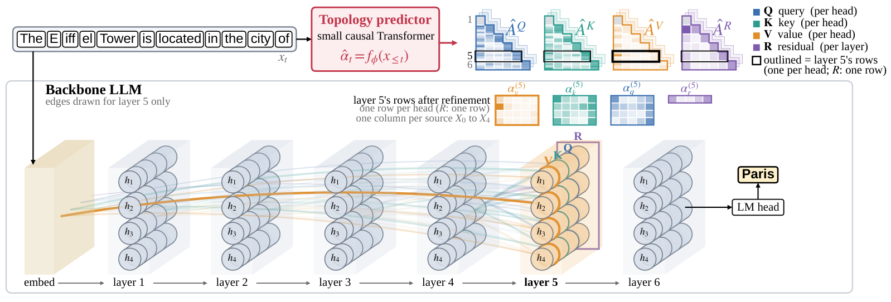

# DAGFormer: Global Topology Prediction for Transformer Cross-Layer Connections

[](https://arxiv.org/abs/2610.19625)

**Xiaocong Yang\*, Yuren Hao\*, ChengXiang Zhai**
<br>AI Interpretability @ Illinois, University of Illinois Urbana-Champaign
<br><sub>\* Equal contribution</sub>

<p align="center">
  
</p>

<sub>**Figure 1.** For token *x<sub>t</sub>*, the topology predictor outputs the planned graph as four triangular matrices, for the query, key and value inputs of every attention head and the residual input of every layer: one column per earlier output, one row per head (one per layer for the residual). Only the edges into layer 5 are drawn, with width proportional to the weight. All weights shown are real values from a trained DAGFormer.</sub>

## Overview

We propose DAGFormer, a Transformer language model whose cross-layer connections are planned by a jointly trained topology predictor. Beyond the residual connections in a standard Transformer, DAGFormer adds direct connections from earlier layers to later ones, and the predictor controls the strength of every connection based on input tokens. Unlike existing cross-layer routing architectures, which set each layer's connections separately, DAGFormer plans the routing of the whole model at once. On matched OLMo-2 pairs from 75M to 1B parameters, DAGFormer lowers WikiText-2 perplexity by 17% to 25% over the vanilla Transformer, and a 1B DAGFormer trained on 5B tokens outperforms the vanilla model trained on 10B. Against four routing baselines with the same data and budget, it reaches the lowest perplexity at 75M, 300M and 1B. The gain carries over to 13 commonsense, science, reading and math evaluation tasks (2.0 to 2.5 points higher mean accuracy at 300M and 1B) and to instruction finetuning (63% to 70% AlpacaEval win rate against the vanilla Transformer, leading every routing baseline), and under structured pruning DAGFormer degrades the least in five of six settings.

In a standard Transformer, a layer sees earlier layers only through the residual stream, the running sum of all their outputs. DAGFormer instead lets every attention head read its query, key and value inputs, and every layer its residual input, as weighted mixtures of the embedding and all earlier layer outputs. A small causal Transformer, the **topology predictor**, reads the input tokens and predicts the weights of all these connections at once; each layer then refines its own weights with a small local module. The predictor is trained jointly with the backbone.

## Results

All comparisons use matched OLMo-2 backbones: the same tokenizer, data order, token budget, optimizer and seed for every model of a size. The 75M to 300M models are trained for about 21 tokens per parameter on Dolma v1.7; the 1B models for 5B tokens, continued to 10B.

**Language modeling.** Held-out WikiText-2 NLL (nats per token; lower is better). Gap to vanilla: vanilla minus DAGFormer. Bold: best per row. –: not run (the baselines were trained at 5B tokens only).

| Size | vanilla | DenseFormer | Hyper-conn. | mHC | MUDDFormer | DAGFormer | Gap to vanilla |
|:---|:---:|:---:|:---:|:---:|:---:|:---:|:---:|
| 75M | 4.997 | 5.027 | 4.964 | 4.913 | 4.974 | **4.711** | +0.29 |
| 150M | 4.268 | 4.246 | 4.220 | 4.209 | **4.041** | 4.085 | +0.18 |
| 300M | 3.808 | 3.745 | 3.692 | 3.652 | 3.649 | **3.544** | +0.26 |
| 1B, 5B tokens | 3.569 | 3.513 | 3.492 | 3.438 | 3.423 | **3.307** | +0.26 |
| 1B, 10B tokens | 3.446 | – | – | – | – | **3.219** | +0.23 |

Prefill time per token relative to the vanilla Transformer (forward pass over 8 sequences of 1024 tokens, compiled, on an NVIDIA A100 40GB; lower is better):

| Size | vanilla | DenseFormer | Hyper-conn. | mHC | MUDDFormer | DAGFormer |
|:---|:---:|:---:|:---:|:---:|:---:|:---:|
| 75M | 1.00 | 1.01 | 1.99 | 1.75 | 1.40 | 1.49 |
| 150M | 1.00 | 1.02 | 2.11 | 1.78 | 1.48 | 1.61 |
| 300M | 1.00 | 1.02 | 2.14 | 1.74 | 1.54 | 1.89 |
| 1B | 1.00 | 1.01 | 1.90 | 1.54 | 1.36 | 1.81 |

**Evaluation tasks.** Base models, mean accuracy (%) per kind of task: commonsense (HellaSwag, PIQA, WinoGrande, CommonsenseQA, Social IQa), science (ARC-Easy/Challenge, OpenBookQA, SciQ), reading (BoolQ, LAMBADA) and math (MathQA, GSM8K, both close to chance at these sizes), and over all 13 tasks. Mean rank: rank among the models of a size, averaged over the 13 tasks (1 = best). Bold: best per row. –: not run (the baselines were trained at 5B tokens only).

| Size | Kind of task | vanilla | DenseFormer | Hyper-conn. | mHC | MUDDFormer | DAGFormer |
|:---|:---|:---:|:---:|:---:|:---:|:---:|:---:|
| 300M | Commonsense (5) | 39.8 | 38.9 | 38.5 | 39.2 | 39.7 | **39.9** |
|  | Science (4) | 36.5 | 36.5 | 38.5 | 38.8 | 38.6 | **39.8** |
|  | Reading (2) | 38.1 | 40.8 | 38.3 | 41.8 | 40.9 | **43.5** |
|  | Math (2) | 11.7 | 12.7 | 12.3 | **12.9** | 11.5 | 12.8 |
|  | Mean (13) | 34.2 | 34.4 | 34.4 | 35.4 | 35.2 | **36.2** |
|  | Mean rank | 4.15 | 4.23 | 3.69 | 2.54 | 3.08 | **2.38** |
| 1B, 5B tokens | Commonsense (5) | 40.0 | 40.2 | 40.7 | 41.1 | 40.7 | **41.8** |
|  | Science (4) | 38.9 | 39.5 | 40.7 | 42.2 | 42.4 | **43.0** |
|  | Reading (2) | 42.1 | 43.0 | 41.6 | 43.8 | 38.3 | **44.7** |
|  | Math (2) | 12.1 | 11.4 | 12.0 | **12.5** | 12.2 | 12.4 |
|  | Mean (13) | 35.7 | 36.0 | 36.4 | 37.4 | 36.5 | **38.1** |
|  | Mean rank | 4.54 | 4.38 | 3.77 | 2.62 | 3.15 | **2.08** |
| 1B, 10B tokens | Commonsense (5) | 40.5 | – | – | – | – | **42.4** |
|  | Science (4) | 41.0 | – | – | – | – | **44.1** |
|  | Reading (2) | 43.0 | – | – | – | – | **47.0** |
|  | Math (2) | 11.5 | – | – | – | – | **12.8** |
|  | Mean (13) | 36.6 | – | – | – | – | **39.1** |

**Instruction finetuning.** Each model finetuned on Alpaca (cleaned) plus Dolly, or on smol-smoltalk. NLL: held-out negative log-likelihood on the instruction data. Win rate: AlpacaEval win rate against the vanilla Transformer of the same size and recipe (both answer orders judged by gpt-5.6-sol, ties count half). Bold: best per row. –: not run, or the vanilla Transformer itself for win rates.

| Size | Metric | vanilla | DenseFormer | Hyper-conn. | mHC | MUDDFormer | DAGFormer |
|:---|:---|:---:|:---:|:---:|:---:|:---:|:---:|
| 300M | Alpaca NLL | 2.392 | 2.342 | 2.298 | 2.277 | 2.256 | **2.203** |
|  | Alpaca win rate | – | 0.55 | 0.59 | 0.58 | 0.63 | **0.65** |
|  | SmolTalk NLL | 1.760 | 1.722 | 1.684 | 1.664 | 1.639 | **1.595** |
|  | SmolTalk win rate | – | 0.57 | 0.58 | 0.62 | 0.64 | **0.70** |
| 1B, 5B tokens | Alpaca NLL | 2.208 | 2.186 | 2.150 | 2.110 | 2.104 | **2.042** |
|  | Alpaca win rate | – | 0.46 | 0.51 | 0.55 | 0.57 | **0.63** |
|  | SmolTalk NLL | 1.728 | 1.706 | 1.673 | 1.633 | 1.617 | **1.558** |
|  | SmolTalk win rate | – | 0.50 | 0.56 | 0.61 | 0.56 | **0.66** |
| 1B, 10B tokens | Alpaca NLL | 2.120 | – | – | – | – | **1.974** |
|  | Alpaca win rate | – | – | – | – | – | **0.66** |
|  | SmolTalk NLL | 1.669 | – | – | – | – | **1.516** |
|  | SmolTalk win rate | – | – | – | – | – | **0.70** |

**Structured pruning.** Pruning during domain finetuning on MathInstruct: held-out NLL of the unpruned finetune (0%) and the damage (loss increase relative to it, %) at 50% and 70% backbone sparsity. Bold: best per row.

| Size | Metric | vanilla | DenseFormer | Hyper-conn. | mHC | MUDDFormer | DAGFormer |
|:---|:---|:---:|:---:|:---:|:---:|:---:|:---:|
| 75M | NLL, unpruned | 2.387 | 2.383 | 2.306 | 2.328 | 2.362 | **2.185** |
|  | Damage at 50% (%) | 9.0 | 9.5 | 9.5 | 9.0 | 10.6 | **7.6** |
|  | Damage at 70% (%) | **17.9** | 18.7 | 19.5 | 20.1 | 22.3 | 22.2 |
| 150M | NLL, unpruned | 1.854 | 1.830 | 1.804 | 1.813 | **1.692** | 1.724 |
|  | Damage at 50% (%) | 9.9 | 9.5 | 9.7 | 9.5 | 12.8 | **9.2** |
|  | Damage at 70% (%) | 21.2 | 20.7 | 21.4 | 21.0 | 28.6 | **20.2** |
| 300M | NLL, unpruned | 1.676 | 1.641 | 1.604 | 1.585 | 1.558 | **1.507** |
|  | Damage at 50% (%) | 7.4 | 7.9 | 7.7 | 8.4 | 9.3 | **6.9** |
|  | Damage at 70% (%) | 17.8 | 18.5 | 17.8 | 18.4 | 22.0 | **16.5** |

More results, ablations and analyses are in the [paper](https://arxiv.org/abs/2610.19625).

## Code

| Path | Contents |
|---|---|
| [`src/model/olmo_graph.py`](src/model/olmo_graph.py) | DAGFormer backbone: OLMo-2 whose per-head query/key/value inputs and residual input mix the embedding and all earlier layer outputs, with the local refinement |
| [`src/model/predictor.py`](src/model/predictor.py) | Topology predictor: a small causal Transformer over the input tokens |
| [`src/model/modular_routing.py`](src/model/modular_routing.py) | Modular variant (paper appendix) |
| [`src/model/denseformer/`](src/model/denseformer), [`hyperconnection/`](src/model/hyperconnection), [`muddformer/`](src/model/muddformer) | Baselines |
| [`src/training/`](src/training), [`src/data/`](src/data), [`src/pruning/`](src/pruning) | Trainer, memory-mapped token data, pruning masks and schedule |
| [`scripts/pretokenize.py`](scripts/pretokenize.py) | Tokenizes Dolma v1.7 into memory-mapped shards |
| [`scripts/pretrain_dagformer.py`](scripts/pretrain_dagformer.py), [`scripts/pretrain_baseline.py`](scripts/pretrain_baseline.py) | Pretraining of DAGFormer and of the vanilla Transformer |
| [`scripts/pretrain_denseformer.py`](scripts/pretrain_denseformer.py), [`scripts/pretrain_muddformer.py`](scripts/pretrain_muddformer.py) | Baseline pretraining |
| [`scripts/prune_finetune.py`](scripts/prune_finetune.py) | Structured pruning during domain finetuning |
| [`scripts/eval_lm_harness.py`](scripts/eval_lm_harness.py) | Evaluation with the lm-evaluation-harness |
| [`configs/`](configs) | YAML configs, e.g. [`pretrain_300m/`](configs/pretrain_300m), [`pretrain_1b/`](configs/pretrain_1b), [`prune/`](configs/prune), [`locality/`](configs/locality) |
| [`tests/`](tests) | Unit tests |

The pretraining scripts for hyper-connections and mHC (`scripts/pretrain_hc_paper.py`, `scripts/pretrain_mhc.py`), instruction finetuning (`scripts/sft/`), chat evaluation (`scripts/chat_eval_*.py`) and the cost benchmark (`scripts/inference_bench.py`) are on the [`pruning/gradual-finetune`](https://github.com/AI-Interpretability-Illinois/dagformer/tree/pruning/gradual-finetune) branch.

## Getting started

```bash
pip install -r requirements-train.txt
python -m pytest tests -q
```

Tokenize the pretraining data once (a batch job; it streams Dolma v1.7 from the Hugging Face Hub):

```bash
python scripts/pretokenize.py --dataset allenai/dolma --dataset-version v1_7 \
    --out-dir <data_dir> --token-budget 21000000000 --seq-len 1024 --seed 0
```

Set `mmap_index_path` (the tokenized data) and `save_dir` (checkpoints) in a config, then train a matched pair, here at 300M on 4 GPUs:

```bash
torchrun --nproc_per_node=4 scripts/pretrain_dagformer.py --config configs/pretrain_300m/300m_fourway_corrected_mb4.yaml
torchrun --nproc_per_node=4 scripts/pretrain_baseline.py --config configs/pretrain_300m/300m_dense_mb4.yaml
```

Evaluate a checkpoint:

```bash
python scripts/eval_lm_harness.py --config configs/pretrain_300m/300m_fourway_corrected_mb4.yaml \
    --ckpt <save_dir>/checkpoint_step<N>.pt --tasks default --output_path results.json
```

The configs keep the cluster paths used for the paper; replace them with your own.

## Citation

```bibtex
@article{yang2026dagformer,
  title   = {{DAGFormer}: Global Topology Prediction for Transformer Cross-Layer Connections},
  author  = {Yang, Xiaocong and Hao, Yuren and Zhai, ChengXiang},
  journal = {arXiv preprint arXiv:2610.19625},
  year    = {2026}
}
```

## Acknowledgments

We thank the INVITE Institute at the University of Illinois Urbana-Champaign and the ACCESS program, through the National Center for Supercomputing Applications (NCSA), for their support with computing credits.

Development notes and the experiment history are in [`docs/project_notes.md`](docs/project_notes.md) and [`experiments/results.md`](experiments/results.md).
